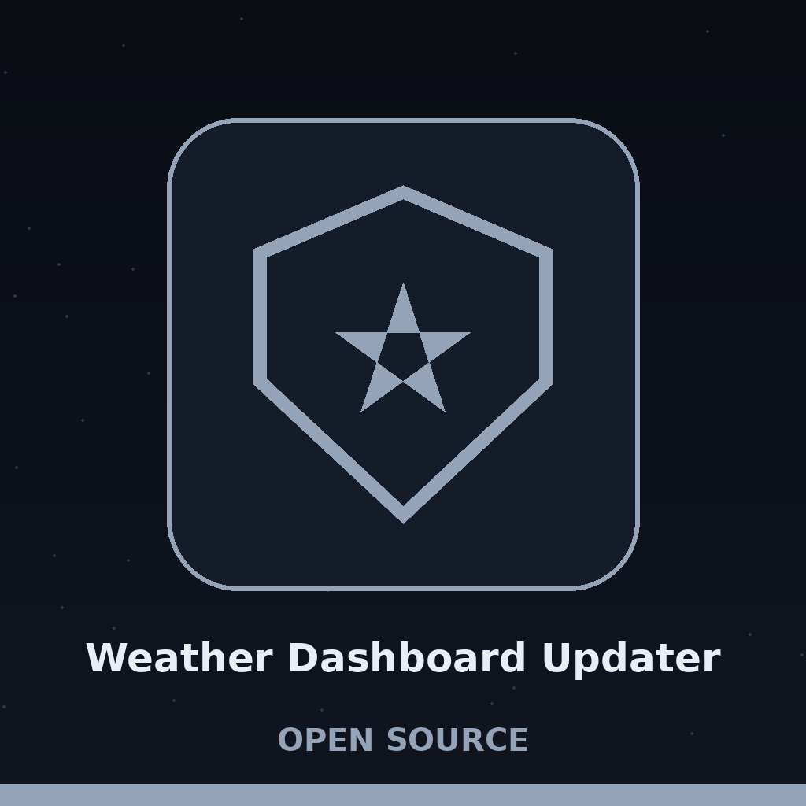

# Weather-Dashboard-Updater


<p align="center"></p>

Gathers data about the weather from OpenWeatherMap API

[home.openweathermap.org/api_keys](https://home.openweathermap.org/api_keys)

# How to run this script?
Go sign up for OpenWeatherMap to obtain an API key, then run:

```
git clone https://github.com/Epsilon0xCell/Weather-Dashboard-Updater.git
rm -rf weatherupdate.csv # Remove the existing .csv as this includes previous data.
API_KEY = Insert_API_Key
pip install requests pandas
python3 get_weather_data.py
```

The file will be output to a .csv in the current working directory, allowing you to view the weather data in .csv format.

# Improving the structure and appearance of the output
The weather data is now saved in a CSV file (`weatherupdate.csv`) with improved structure and readability. The script `get_weather_data.py` extracts weather data from the OpenWeatherMap API and saves it to a CSV file, with the data well-organized and formatted for easy readability.

# Interpreting the structured weather data
The CSV file contains the following columns:
- `coord_lon`: Longitude of the location
- `coord_lat`: Latitude of the location
- `weather_id`: Weather condition id
- `weather_main`: Group of weather parameters (Rain, Snow, Extreme, etc.)
- `weather_description`: Weather condition within the group
- `weather_icon`: Weather icon id
- `base`: Internal parameter
- `main_temp`: Temperature. Unit Default: Kelvin, Metric: Celsius, Imperial: Fahrenheit.
- `main_feels_like`: Temperature. This temperature parameter accounts for the human perception of weather.
- `main_temp_min`: Minimum temperature at the moment. This is minimal currently observed temperature (within large megalopolises and urban areas), unit: Kelvin.
- `main_temp_max`: Maximum temperature at the moment. This is maximal currently observed temperature (within large megalopolises and urban areas), unit: Kelvin.
- `main_pressure`: Atmospheric pressure (on the sea level, if there is no sea_level or grnd_level data), hPa
- `main_humidity`: Humidity, %
- `visibility`: Visibility, meter
- `wind_speed`: Wind speed. Unit Default: meter/sec, Metric: meter/sec, Imperial: miles/hour.
- `wind_deg`: Wind direction, degrees (meteorological)
- `clouds_all`: Cloudiness, %
- `dt`: Time of data calculation, unix, UTC
- `sys_type`: Internal parameter
- `sys_id`: Internal parameter
- `sys_country`: Country code (GB, JP etc.)
- `sys_sunrise`: Sunrise time, unix, UTC
- `sys_sunset`: Sunset time, unix, UTC
- `timezone`: Shift in seconds from UTC
- `id`: City ID
- `name`: City name
- `cod`: Internal parameter

# Validating the CSV structure
The script now includes a validation step to ensure the CSV file has a consistent structure before appending new data. The `validate_csv_structure` function checks the structure of the existing `weatherupdate.csv` file and removes or corrects any inconsistent rows. This helps prevent errors when reading the CSV file with `pd.read_csv`.
